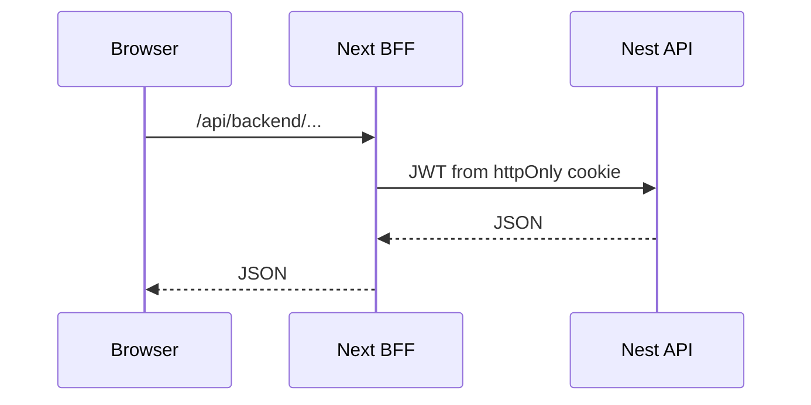

# Architecture

Rules: `.cursor/rules/clean-architecture.mdc` (backend), `.cursor/rules/frontend-data.mdc` + `design-system.mdc` (frontend).

## System

```text
Browser → Next.js (FSD + BFF) → NestJS API → PostgreSQL
                              ↘ Redis (cache / throttle)
```

Shared contracts: `@default/types`. Helpers: `@default/utils`.

## Backend

```text
domain/ → application/ → presentation/     (domain tier — auth, users, RBAC, …)
              ↑ infrastructure/

modules/<name>/  controller → service → repository   (simple tier — e.g. announcements)
```

| Module | Tier | Role |
|--------|------|------|
| Announcements | Simple | Example CRUD (`backend/src/modules/announcements/`) |
| Auth | Domain | Login, refresh, MFA, OIDC |
| User | Domain | CRUD, export/anonymize |
| Authorization | Roles, permissions |
| SiteSetting | Singleton CMS-style settings |
| Media | S3-compatible upload |
| Dashboard | Admin stats |
| Audit | HTTP audit trail + admin list |

Drizzle: `backend/src/infrastructure/database/drizzle/`, migrations in `drizzle/migrations/`.

## Frontend

```text
@default/types → @default/api → @default/hooks → features | widgets
```

Layers: `app` → `widgets` → `features` → `entities` → `shared`. Features must not import widgets.

BFF: `frontend/app/api/auth/*`, `frontend/app/api/backend/*`, `frontend/src/shared/lib/bff-*`.

## Admin request flow



Extend after fork: [fork.md](fork.md).
